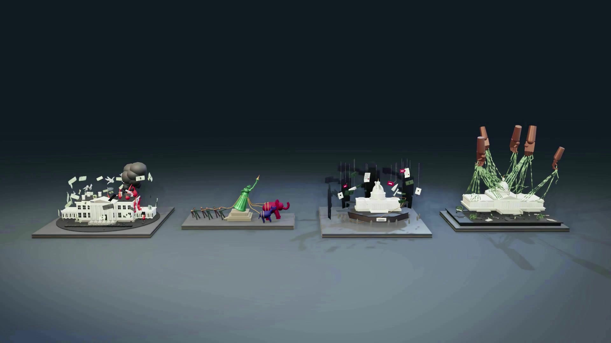

# Four political sculptures — 135-second film

[Watch or download the film on GitHub](https://github.com/karthiksrikumar/personalwebsite/raw/refs/heads/main/film/output/political-sculptures-135s.mp4).

1920 × 1080, 24 fps, 135 seconds, H.264 with stereo AAC audio. The film includes exactly **Price of Power, Liberty Tug of War, Capitol at Auction, and Capitol Marionette**. No text overlays are added.



## Camera and construction design

The full-model orbit and flyby cameras are fitted to the measured geometry of each sculpture. The camera solver projects all eight bounding-box corners, accounts for object depth and camera elevation, and reserves breathing room around the outermost parts. Intentional close passes aim at named OBJ components: the Price of Power pediment and flames, Liberty's crown and ropes, Auction's dome and bidding props, and Marionette's hand and strings. These detail shots deliberately crop the rest of the model. The collection uses four separate pedestals in a single row; their projected bounds are checked for overlap.

Each sculpture now gets a bottom-up build through its actual source meshes: five seconds for Price of Power, Capitol at Auction, and Capitol Marionette, followed by the original 15-second Liberty build. Parts stay at their final coordinates throughout. Stencil cross-sections close the visible cut surfaces with their original material colors. Clipped geometry also stops casting shadows. Ambient occlusion and the depth-of-field pass are disabled during construction so their depth buffers cannot reveal unbuilt surfaces. The solid cut-surface method follows [Three.js's clipping and stencil example](https://threejs.org/examples/webgl_clipping_stencil.html).

| Time | Shot |
| --- | --- |
| 0–3s | Short wide introduction to the four separated sculptures |
| 3–13.5s | Price of Power: orbit, pediment/flame detail push, flyby |
| 13.5–24s | Liberty Tug of War: orbit, crown/rope detail push, flyby |
| 24–34.5s | Capitol at Auction: orbit, dome/bidding detail push, flyby |
| 34.5–45s | Capitol Marionette: orbit, hand/string detail push, flyby |
| 45–48.75s | Price of Power: tracking close-up of a suspended figure amid flying money |
| 48.75–52.5s | Liberty: tight moving pass across the elephant's head, ears, and trunk |
| 52.5–56.25s | Auction: macro orbit around a bidder's paddle |
| 56.25–60s | Marionette: follow a hand and its severed strings |
| 60–63.75s | Price of Power: full 360-degree orbit, then a push toward a floating figure |
| 63.75–67.5s | Liberty: full 360-degree orbit, then donkey close-up |
| 67.5–71.25s | Capitol at Auction: full 360-degree orbit, then a price-tag close-up |
| 71.25–75s | Capitol Marionette: full 360-degree orbit, then a dome-finial close-up |
| 75–80s | Price of Power forms from its base upward, with a camera arc |
| 80–85s | Capitol at Auction forms from its base upward, with a camera arc |
| 85–90s | Capitol Marionette forms from its base upward, with a camera arc |
| 90–105s | Liberty forms from the bottom upward in fixed, solid layers, with a camera arc |
| 105–108.75s | Post-build moving inspection of Price of Power's portico capitals |
| 108.75–112.5s | Liberty's shackle and chain from changing angles |
| 112.5–116.25s | Capitol at Auction's rooftop statue and pedestal |
| 116.25–120s | Another marionette hand and its articulated fingers |
| 120–129s | Completed Liberty, with a moving crown detail shot |
| 129–135s | Short four-piece finale; fade at 133s |

The close-ups were selected from named components in `geometry-analysis.json`, rather than arbitrary camera targets. The new insert first circles each entire sculpture through 360 degrees, keeping its full measured bounds in frame. It then cuts to a close, panning view of another small component. The earlier detail moves follow the tracking-shot principle of keeping a clear subject while revealing it through changing perspective; see [Adobe's tracking-shot guide](https://www.adobe.com/creativecloud/video/production/cinematography/camera-shots-and-angles/tracking-shot.html). The exact selection patterns and camera paths are in `scene.mjs`.

Lighting uses large warm and cool softboxes, moving key illumination, rim light, an environment-light approximation, and a seamless slate backdrop. Materials preserve the MTL color and opacity values, with added physical roughness and metalness. Rendering uses shadow maps, screen-space ambient occlusion, environment reflections, restrained depth of field, multisample antialiasing, ACES tone mapping, and two shutter samples per frame. This is a rasterized PBR scene rather than a path-traced scene.

## Source assets

Only these pairs are loaded, directly from `obj/`:

- `price-of-power.obj` / `.mtl`
- `liberty-tug-of-war (1).obj` / `.mtl`
- `capitol-at-auction.obj` / `.mtl`
- `capitol-marionette.obj` / `.mtl`

Liberty's downloaded files have a `(1)` suffix, while its embedded `mtllib` line uses the unsuffixed filename. The scene explicitly loads the provided suffixed MTL and assigns it to the OBJ loader. The original files remain intact. The other sculptures and the head STL are excluded.

`analyze-models.py` measures the vertices referenced by each named component and records exact source bounds and triangle counts. Rendering batches geometry by material without reducing triangle counts. `scene.mjs` contains the complete scene, camera, lighting, materials, construction animation, and timeline; no Blender project is needed.

## Reproduce

From the repository root, with Node 22+, Python 3.12+, and WebGL2-capable Chromium:

```sh
npm ci
npx playwright install chromium
python -m pip install numpy pillow imageio-ffmpeg
python film/analyze-models.py
node film/render.mjs --preview
node film/verify-scene.mjs
git restore --source=fe38f64cfe33f6132207617ff6b817319f8885a1 -- film/output/political-sculptures-120s.mp4
python film/extend-frames-135.py
node film/render.mjs --only=105:120
python film/finish.py
node film/verify-playback.mjs
```

Set `CHROME_PATH` to use an existing Chromium executable. Set `FFMPEG_PATH` to use an existing FFmpeg executable with libx264 and AAC support. The encoder is otherwise found through the Python `imageio_ffmpeg` package or a project-local installation in `.cache/film-tools`.

Previews go to `.cache/film135-preview`. `extend-frames-135.py` checks the SHA-256 of the prior verified 120-second film, extracts its 2,880 frames, and shifts the last 15 seconds after a 360-frame gap. The new 15-second post-build inspection montage fills that gap. This retains the earlier edit without spending render time on unchanged shots; the original footage is decoded and encoded again, so it incurs one additional compression generation. The final frame directory is `.cache/film135-frames` with 3,240 JPEGs. Interrupted new-shot renders can resume with the same `--only=105:120` command. Clear that exact frame directory before rebuilding from scratch after scene changes.

`finish.py` generates an original evolving ambient score with accents aligned to the layer build, encodes the MP4 with BT.709 color metadata, and fully decodes both streams to check the result. No outside music recordings are used.

## Verification

- `output/geometry-analysis.json`: source geometry bounds for every component of the four requested models.
- `output/model-inventory.json`: only the four selected assets, materials, and preserved triangle counts.
- `output/assembly-parts.json` and `assembly-events.json`: normalized Liberty bounds and sound cue times.
- `output/scene-verification.json`: asset-loading, framing, separation, and near-camera checks sampled every half second.
- `output/contact-sheet.jpg`: representative frames, including several stages of construction.
- `output/verification.json`: 135-second duration, 3,240 decoded frames, resolution, source/video checksums, audio levels, and browser playback through the ended event.

Sampled camera checks supplement visual review; they are not an exhaustive geometric collision proof.

## Local storage cleanup

After committing and pushing, `cleanup-local.ps1 -Commit <full-commit-sha>` verifies that GitHub `main` matches the commit, then streams the actual remote MP4 through SHA-256 and compares it with the verified local video. Only after those checks does it remove local video copies, old and new film frame caches, scratch soundtracks, preview caches, and the cached encoder. Models, source scripts, and small review/verification artifacts remain.

The committed 135-second MP4 is marked `skip-worktree` before its local copy is removed, so local cleanup does not delete the GitHub artifact. Download it from the link above, or restore the working copy with:

```sh
git update-index --no-skip-worktree film/output/political-sculptures-135s.mp4
git restore --source=HEAD -- film/output/political-sculptures-135s.mp4
```

Git history is retained, so the Git object database still contains committed video data.
